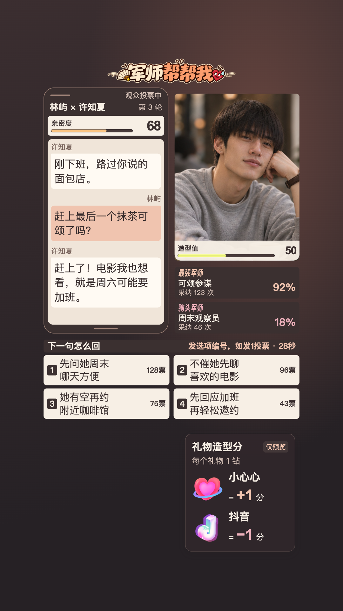

# 恋爱军师团 · 抖音互动游戏与 AI 数字人工作台

女生发来一句「你怎么还没走？」，男主该怎么回？在《恋爱军师团》里，直播间的观众就是他的军师。大家在弹幕里支招、投票，数字人面对镜头说出自己的想法，再低头给女生发消息。女生看到的只有正式聊天；她怎么回、亲密度怎么变，会成为观众下一轮支招的依据。

项目开发已结束，本仓库公开保留源码和使用说明。节目在 Mac 上运行，模型服务与数字人账号由使用者自行配置。可以只玩文字版，也可以接入 Vidu 实时数字人，用 OBS 合成竖屏画面，再从抖音直播伴侣播出。

[直播游戏画面](#直播游戏画面) · [项目来历](#项目来历) · [游戏与改造方案](#游戏与改造方案) · [节目配置示例](#恋爱军师团当前定版角色) · [从零配置](#1-配置本机环境) · [OBS 与抖音](#obs-与抖音直播伴侣) · [离线检查](#离线检查)

## 直播游戏画面

<p align="center">
  <a href="docs/images/live-game-voting.png"></a>
</p>

图中是 OBS 节目页的投票预览，使用模拟对话、昵称和票数，人物为静态造型。女生说周六可能要加班，观众可以发 `1` 选「先问她周末哪天方便」。点击图片可查看 1080 × 1920 原图。

## 项目来历

做这个项目时，我参考的原方案是天工开帧的「赛博小雅直播版」：观众发来弹幕，数字人能在直播中接话、做动作。《恋爱军师团》沿用这种互动思路，把观众的输入进一步变成有投票、有作者、有剧情后果的一轮游戏。[天工开帧 · 赛博小雅直播版](https://github.com/cyber-xiaoya/cyber-xiaoya-live)

代码上，数字人工作台基于 Gary（曹淦）的 `ai-live-avatar`。本仓库在 `ai-live-avatar/studio/` 中实现游戏表演、外接百炼语音和动作调度。抖音事件采集使用仓内的 DyHub 副本，保留了该节目需要的礼物、场次识别和重连处理。[Gary 的数字人底座](https://github.com/garycaogan/ai-live-avatar) · [DyHub 上游](https://github.com/ymstar/dyhub) · [采集器接口与启动说明](dyhub/README.md)

## 游戏与改造方案

**一场直播可以玩多期，一期故事可以有多轮聊天。** 每期生成一对虚构成年角色、各自的性格与当前处境，亲密度从 50 开始。以女生的开场消息为起点，每轮按下面的顺序进行。

1. **征集建议。** 观众可以投稿一句原话，也可以给行动方向。同一人先支招、后闲聊，两条都保留。征集截止后，模型从实际投稿中选出最多四项，每位作者最多占一个选项。冒险或可能翻车的建议也能入选。没有合适建议时，男主自拟回复。
2. **投票与裁决。** 观众发送对应编号，例如 `1`、`投1` 或 `投 1`。同一人以截止前最后一张有效票为准。男主通常采纳最高票，出现并列时程序从并列项中抽取一次。只有最高票与男主人设冲突时，才有 25% 的机会改选或自拟。关票后的票数和裁决都保存，刷新页面不会重抽。
3. **口播、发消息、结算。** 数字人可以对观众说出选择的理由。正式男主消息进入屏幕聊天，女生依据她知道的事回应。游戏把女生回复与分数变化一起写入 SQLite，再显示结果。亲密度到 100 为成功、到 0 为失败。游戏把被采纳的建议记回原作者，同一次抖音直播中的成绩可跨期计榜。

礼物驱动的是另一项**造型值**。例如在一钻礼物配置中，小心心（ID `463`）正向、抖音（ID `164`）负向；从 50 分累计加到 60，男主从灰卫衣换到精致档。亲密度随聊天结算，造型变化可能带来小幅印象修正；军师榜只统计聊天得分。工作台的「开始免费试玩」可用模拟加减分看效果；真实收礼与云端换形还需要账号、房间和资产配置。[玩法与计分](romance-advisors/README.md) · [一钻手测步骤](romance-advisors/docs/04-本地工作台使用.md#一钻手测)

### 从哪里开始改

游戏采用单进程和 SQLite。模型写人物、选项摘要和台词；程序掌管窗口、票数、建议作者、已发消息与分数。保留这条分工，改剧情时就不容易让模型顺手改掉观众的票。

| 想改什么 | 从哪里下手 | 怎样检查 |
| --- | --- | --- |
| **换人物或节目题材** | 从 [model.py](romance-advisors/romance/model.py) 的 `prepare`、`draft`、`reply` 三组提示词入手。例如把咖啡馆约会改成久别重逢，沿用「观众献策 → 当事人选择 → 对方回应」。如果要改成职场谈判，还需在 [game.py](romance-advisors/romance/game.py) 和前端一起替换亲密度、胜负条件及文案。 | 用一条有明确作者的建议走完一轮，核对男主保留原意、对方只知道公开聊天、奖励归实际作者。 |
| **调快或放慢节奏** | 先在工作台的自动推进设置里调征集和投票秒数。要改平票或人设冲突规则，再看 [game.py](romance-advisors/romance/game.py) 的 `_decide()`。 | 用两位模拟观众试平票、改票、关票后再发票，然后刷新，核对最终结果和作者。 |
| **换节目版式** | [renderer.js](romance-advisors/static/renderer.js) 绘制聊天、选项与榜单，[scene-layout.js](romance-advisors/static/scene-layout.js) 定位人物和镜头。可先在工作台调边距和人物位置，再到 [OBS 节目页](romance-advisors/static/obs-output.html)检查效果。 | 用四个选项和一条长回复检查手机裁切，再到 OBS 看完整的 1080×1920 画面。 |
| **换礼物、门槛或造型** | 游戏侧配置正负礼物 ID 与分档门槛，计分和连击去重见 [appearance.py](romance-advisors/romance/appearance.py)。换脸或服装还需在 Studio 给同一角色绑定六档资产。 | 先模拟跨档再回退，确认仅造型值变化。真实礼物另核对收件数、去重、实际画面与恢复口播档。 |

## 《恋爱军师团》当前定版角色

下表是可参考的咖啡馆节目配置，不附带任何账号、套餐、云资源或托管 Agent。请在自己的账号下开通所需功能，创建有权使用的数字人资产，并在本机运行自己的游戏与 Studio。

| 环节 | 节目配置示例 |
| --- | --- |
| 文字 | 游戏和 Studio 默认适配百炼 `qwen3.8-flash`、北京地域、关闭思考；按自己的账号选择普通 API 或可选文字套餐。 |
| 语音 | 普通百炼通道调用 `qwen-audio-3.1-tts-flash`，六档使用同一音色 `longtian_v3.1`。 |
| 人物与动作 | Vidu 实时数字人。Studio 取已确定的台词、合成语音并调度眼神、表情与局部动作。浏览器通过 AliRTC 接收云端音画。 |
| 普通口播 | 「咖啡馆里的温柔凝视」，黑针织衫托腮；复现时填入自己账号下对应的 Vidu 资产 ID。六档中对应 `stellar`。 |
| 进入与退出游戏 | 启用真实六档时，开局从 50 分的 `normal` 灰卫衣开始。结束游戏后回到本场口播档 `stellar`。 |

| 0 · 鱼头 | 50 · 普通 | 80–100 · 巨帅 |
| :---: | :---: | :---: |
|  |  |  |

默认六档依次为 `fish`（0）、`rough`（1–19）、`tired`（20–39）、`normal`（40–59）、`refined`（60–79）、`stellar`（80–100）。图中是仓内预览素材。口播[展示原图](romance-advisors/static/assets/preview-male-3x4.png)的 SHA-256 为 `30294e6e775dcdb55aa689bdd290256ecf2cfe06a3a967c0c27de52d5a9cef00`，换机器后可据此核对。云端可驱动资产由各自的 Vidu 账号管理。

## 1 配置本机环境

本教程以 macOS 为例；一键准备依赖 macOS 应用、zsh 和 Unix 文件锁。克隆整个仓库，让 `romance-advisors/`、`ai-live-avatar/`、`dyhub/` 保持同级。在希望存放项目的目录执行以下命令，需要 Python 3.11+ 和可用的 `ffmpeg`、`ffprobe`。如使用其他受支持的 Python 版本，替换命令中的解释器名。

```sh
git clone https://github.com/patonypa816/romance-advisors.git
cd romance-advisors
python3.11 -m venv romance-advisors/.venv
romance-advisors/.venv/bin/python -m pip install -r romance-advisors/requirements.txt
python3.11 -m venv ai-live-avatar/.venv
ai-live-avatar/.venv/bin/python -m pip install -r ai-live-avatar/requirements.txt
ffmpeg -version
ffprobe -version
sh ai-live-avatar/tools/fetch_vendor.sh
```

最后一步下载并校验 AliRTC 浏览器 SDK 7.1.9。只玩文字版时，安装游戏端的 Python 依赖、配置文字模型并启动游戏即可；接收抖音事件时，再准备 Node.js 20+、Chrome/Chromium 并构建 DyHub。

## 2 配置自己的账号

这里的 Agent 是在本机运行的游戏模型与 Studio 编排程序：它接收输入、请求模型，再由程序校验和执行。默认接法不需要 CloudBase，也不需要额外创建托管 Agent。若自行开发云端 Agent，请在自己的账号创建、配置权限和服务接口，再编写适配；仓库不提供公共代调用服务。

先按实际功能准备凭据，避免把可选服务当成必装项：

| 要使用的功能 | 自己需要准备什么 |
| --- | --- |
| 合成测试、静态造型试玩 | 无云凭据；不能据此验证真实剧情或音画 |
| 纯文字游戏 | 自己的百炼文字模型权限与密钥；可选自有文字套餐 |
| Studio 评论筛选、台词与动作计划 | 自己的百炼文字模型配置 |
| 外接语音 | 自己的普通百炼 CSV 与可用 TTS 音色；文字套餐不提供这路语音凭据 |
| Vidu 实时人物 | 自己的 Vidu 密钥、可用额度与有权驱动的资产 |
| 抖音评论、OBS 输出 | 自己有权使用的直播间和本机软件；不需要 CloudBase 密钥 |
| 自建 CloudBase 适配 | 仅在选择这一独立开发路径时，准备自己的环境、模型权限和服务端凭据 |

1. **在仓库外保存所需密钥。** 参考[配置模板](config-examples/README.md)，自行填写百炼 CSV 或 Vidu 密钥文本。只玩文字游戏不必准备 Vidu。真实文件设为仅本人可读，不把密钥写进源码、前端、issue 或 Git。
2. **在仓库根创建统一引用文件。** 两个应用默认读取根目录 `.local/local-settings.json`，这里只写外部凭据文件的绝对路径。首次在仓库根执行：

   ```sh
   mkdir -p .local
   cp -n config-examples/local-settings.example.json .local/local-settings.json
   chmod 700 .local
   chmod 600 .local/local-settings.json
   ```

   用本机编辑器把 `bailian_credentials_file` 改成自己 CSV 的绝对路径；只有使用 Vidu 时才填写 `vidu_credentials_file`。未启用功能可以保留对应占位值，调用该功能前必须替换。不要把真实文件放进仓库；`.local/` 是本机私有配置目录。
3. **选择自己的文字路由。** 默认使用上述普通百炼配置。纯文字游戏也支持 `ROMANCE_CREDENTIALS_FILE` 显式指向自有 CSV。若自己的账号有受支持的 Token Plan，可把 [qwen-route.example.json](config-examples/qwen-route.example.json) 分别放到 `romance-advisors/data/qwen-route.json` 与 `ai-live-avatar/studio/data/qwen-route.json`，自行创建目录，并填写外部套餐密钥文件的绝对路径。两端独立配置，显式路由错误会拒绝调用，不自动切换收费来源；TTS 和 Vidu 仍需各自凭据。Studio 模型选项见 [bailian-brain.example.json](config-examples/bailian-brain.example.json)。
4. **已有安装升级时显式迁移。** 正常停场并退出两个服务后，自己检查原先的引用文件，把需要保留的路径字段复制到新的 `.local/local-settings.json`，再核对文件权限和路径。程序不自动搜索旧目录、读取旧凭据或迁移账号；已显式配置的环境变量和套餐路由仍应由自己核对。不要用旧机器的运行目录覆盖新机器。
5. **选择自己的角色与音色。** 启动 Studio 预览，在资产页同步并选择自己账号的 Vidu 资产；自行编写角色名称、人设和回复偏好。正常停场并退出后，按 [tts-voices.example.json](config-examples/tts-voices.example.json) 把「资产 ID → 音色 ID」合并进生成的 `ai-live-avatar/studio/data/local.json` 的 `tts_voices`，保留端口、令牌等其他字段。重新启动并核对选中资产及 `tts_voice`。新安装兜底音色为 `libai_v3.1`，不代表已经完成节目配置。
6. **可选，启用真实六档换形。** 静态试玩可直接使用。真实换形需要自己的六个就绪资产、各自缓存原图的 SHA-256、音色绑定，以及云端能访问的升级和降级两支 HTTPS 短片。填写 [关闭状态模板](config-examples/external-appearance.example.json) 后保存为 `ai-live-avatar/studio/data/external-appearance.json`，设置自己的 `character_id` 和开场 `broadcast_key`；素材、权限和费用确认后才启用，在下次正常启动时读取。[六档说明](ai-live-avatar/studio/EXTERNAL_APPEARANCE.md)

### 开发者：接自己的模型或云端 Agent

当前并非任意 API 即插即用。游戏的 [QwenModel.generate(task, payload)](romance-advisors/romance/model.py) 使用百炼兼容端点和结构化结果，地址有白名单限制；可从这个入口实现自己的模型适配，并保留 `prepare`、`select`、`draft`、`reply` 等任务的返回合同、来源约束、错误与取消处理，再接入游戏服务。只改模型名或 URL 不能保证兼容。

Studio 当前由 [bailian_ai.py](ai-live-avatar/studio/bailian_ai.py) 提供百炼传输，复用 [cloudbase_ai.py](ai-live-avatar/studio/cloudbase_ai.py) 的结构化计划与校验。若使用自己的模型/Agent，需要实现筛选、回复、主持与动作排程等实际调用接口，并接入 [automation.py](ai-live-avatar/studio/automation.py) 的实例创建处；TTS 与 Vidu 是另外两条调用链，不随文字适配器切换。[自定义模型与可选 CloudBase](ai-live-avatar/studio/README.md#自定义模型与可选-cloudbase) 提供独立开发入口，不是正常工作台的配置开关。自行接线后，先验证返回结构、来源、取消和停止，再授权真实调用。

## 3 先启动 Studio 再启动游戏

只玩文字游戏时跳过 Studio，直接使用本节第二个终端的游戏启动命令。接实时数字人时再按以下顺序运行。

**桌面预览**用两个终端，各自从仓库根目录开始。第一个启动 Studio，让工作台预览接收音画。

```sh
cd ai-live-avatar
.venv/bin/python -B studio/server.py --preview
```

打开终端打印的本机工作台地址。Studio 地址可能包含本机访问令牌，请保留在自己电脑上。第二个终端启动游戏。

```sh
cd romance-advisors
.venv/bin/python -B -m romance.launcher
```

游戏从同级 Studio 的 `studio/data/runtime.json` 找到数字人。想先了解规则，可在游戏工作台打开「本地调试」（`/?debug=1`），模拟两位观众的投稿和投票。「开始免费试玩」适合看六档外观；创建真实文字剧情会请求模型，点「启动数字人」会创建计费云场，口播会用到 TTS。[工作台使用说明](romance-advisors/docs/04-本地工作台使用.md)

## OBS 与抖音直播伴侣

这套接法在同一台 Mac 上运行游戏、Studio、DyHub、OBS 和直播伴侣。**画面**从游戏节目页进入 OBS，再由 OBS Virtual Camera 送给伴侣。**声音**从同一节目页进入 OBS 调音台，由 OBS 的监听设备送入 BlackHole 2ch（虚拟声卡），伴侣把它当作音频输入。**弹幕与礼物**走另一条路，由 DyHub 从本次直播间送回游戏。

### 首次配置 OBS

1. 安装 [OBS Studio](https://obsproject.com/download)、[BlackHole 2ch](https://github.com/ExistentialAudio/BlackHole) 和抖音直播伴侣。macOS 准备器默认从 `/Applications/OBS.app` 和 `/Applications/Douyin Webcast Mate.app` 打开这两个桌面应用。若之前使用桌面预览，先正常结束云场、退出该模式的服务。在两个终端分别进入 `ai-live-avatar/` 和 `romance-advisors/`，前者运行 `.venv/bin/python -B studio/server.py`，后者运行 `.venv/bin/python -B -m romance.server --obs-output`。这次由 OBS 节目页独占数字人接收端。记下**游戏终端**打印的 `http://127.0.0.1:<端口>`。
2. 在 OBS 新建一个专用**配置文件（Profile）**和同名的**场景集合**，例如都叫「恋爱军师团」。把基础画布和输出分辨率都设为 **1080×1920**，帧率用 **30 fps**。集合内建一个节目场景。
3. 在该场景添加一个可见的**浏览器源**，来源名称精确填写 **恋爱军师团专用节目页**。网址填 `http://127.0.0.1:<游戏端口>/static/obs-output.html`，宽 1080、高 1920，勾选「通过 OBS 控制音频」。这个地址同时包含人物、聊天、投票和榜单；`/overlay` 只提供透明游戏组件。只让一个场景使用这个专用源，方便准备器识别。
4. 在 OBS 的「高级音频属性」把该源设为**监听和输出**，在 OBS 设置中将**音频监听设备**选为 **BlackHole 2ch**。把虚拟摄像机的输出选为 **Program（节目）**，启动虚拟摄像机。
5. 在抖音直播伴侣新建竖屏场景，视频来源选择 **OBS Virtual Camera**，音频输入选择 **BlackHole 2ch**。看伴侣里是否有完整的竖屏游戏界面；有实际声音时，看伴侣电平并试听，检查是否有静音或同一声音被桌面采集重复送入。可先本地录一小段回放，同时检查声音、人物嘴形和手机边缘裁切。

首次配置并检查完毕后，保存配置。若开了数字人，先确认云场已正常结束，再正常退出手动打开的 OBS。第一次双击「开播准备」时，让准备器用保存的配置文件、场景集合和场景名启动 OBS，以便它核对本次运行的确是专用节目。

**首次手动启动**由游戏分配空闲端口；**下次一键准备**从已保存的浏览器源 URL 读取端口，在同一地址启动或复用本项目。准备器要求专用源、场景和配置唯一匹配。若提示端口冲突或已有预览进程，先在空闲时正常退出原实例再准备。[OBS 配置检查源码](romance-advisors/romance/broadcast_apps.py)

### 接收抖音事件与日常开播

首次从仓库根目录构建采集器。仓内版本包含本项目使用的直播场次和礼物字段。

```sh
cd dyhub
npm ci --ignore-scripts
npm run build
```

随后双击根目录的 [开播准备.command](开播准备.command)。它检查已保存的 OBS 设置，启动或复用本机 Studio、DyHub 和游戏，准备虚拟摄像机并打开直播伴侣、游戏工作台。采集器管理地址是 `http://127.0.0.1:8757`；如需单独排查采集，可使用[采集器启动入口](ai-live-avatar/studio/启动评论采集.command)。需要登录态时由操作者在本机管理台处理。[DyHub 本机说明](dyhub/README.md)

| 操作者做什么 | 怎样确认 |
| --- | --- |
| 在游戏工作台保存自己的数字房号或直播页链接，在伴侣核对画面、音频来源后点击「开始直播」。 | 工作台检测开播，间隔至少 5 秒复核同一平台场次后接入。在自己的直播间发一条可辨认的弹幕，看工作台是否收到。 |
| 点「启动数字人」进入普通口播，需要互动剧情时点「开始游戏」。 | 在伴侣和观众端分别确认能听见台词、看见动态人物。游戏收票期间，用当前有效编号核对票数；同一场直播的正式榜可跨游戏期延续。 |
| 点「结束游戏」返回普通口播；整场结束时在直播伴侣下播。 | 游戏在连续确认本场下播后停止订阅，请求结束归属本场的数字人。看工作台回读的云端结束结果。若平台状态未知或掉线，用「结束数字人」处理并核对，再退出本机服务。 |

## 离线检查

以下命令分别从仓库根目录执行。测试用合成数据检查游戏规则、前端和 Studio，适合改完一部分后复查对应行为。

```sh
(cd romance-advisors && PYTHONPATH=.:tests .venv/bin/python -B -m unittest discover -s tests -p 'test_*.py')
(cd romance-advisors && node --test tests/test_*.cjs)
(cd ai-live-avatar && PYTHONPATH=studio .venv/bin/python -B -m unittest discover -s studio -p 'test_*.py')
(cd dyhub && npm run typecheck && node --import tsx --test test/*.test.ts)
```

Studio 的[音频发送节奏测试](ai-live-avatar/studio/test_prepared_pcm_overlap.py)使用合成语音与本地播放器替身，检查准备下一句时是否打断当前音频。

实际使用时分别检查观众端音画、低头与聊天气泡的时序，以及礼物换形和恢复口播；发送回执只表示本机发送，不等于观众已收到或画面已执行。

## 源码、素材与许可

[游戏代码](romance-advisors/romance/) · [前端与节目页](romance-advisors/static/) · [Studio 工作台](ai-live-avatar/studio/README.md) · [DyHub](dyhub/) · [配置模板](config-examples/README.md)。程序运行后生成的数据库、登录态、令牌、录制和本机资产绑定由操作者保存在自己的机器上。

各组件保留自己的许可：[数字人底座 MIT](ai-live-avatar/LICENSE)、[字体 OFL](romance-advisors/static/fonts/OFL.txt)、[DyHub MIT](dyhub/LICENSE) 以及[第三方抖音签名组件的 AGPL-3.0 说明](dyhub/third_party/douyin-sign/README.md)和[许可证全文](dyhub/third_party/douyin-sign/LICENSE)。仓库根目录目前没有为整个组合项目声明统一许可证。
