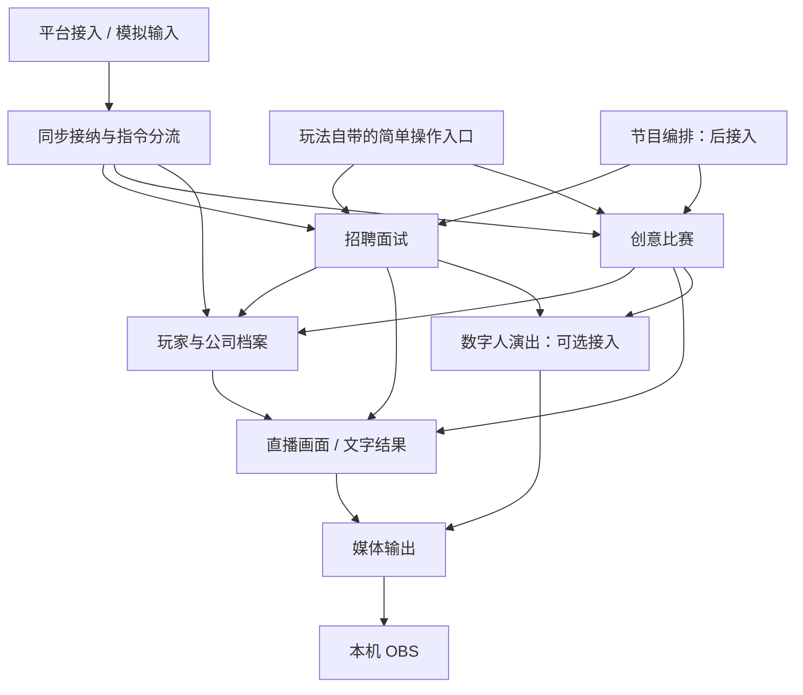

# HELL INC. 地狱招聘局：当前实施规格

规格基线：V0.5｜日期：2026-11-01｜性质：待实现的目标规格。

实际实现和验证状态只看 [HANDOVER.md](../HANDOVER.md)。本文件描述计划中的行为，不证明对应代码或外部接口已存在。

本文件是仓库内唯一的当前实施规格，包含产品边界、独立模块、数据与模型约束、交付顺序和验收。无需查阅任何旧版设计稿或开发者电脑上的文件。

首版规模：一个直播间、一个公司世界、一个 HR，创意比赛按 12 份投稿验收，有操作者处理异常。自动主持保留；首版不要求自动故障接管、跨机器热切换或无人值守恢复。

**用户已确认：保留整轮结算。个别作品 AI 评分失败时，补评完成后再展示、投票；不把失败作品记零分，不拆分人气奖与 AI 创意奖的结算。**

## 1. 保持目标，分清交付层次

已确认的产品目标不变：抖音中文观众、沿用现有弹幕抓取、游客可先参加创意任务与投票、面试后职业成长、轻松奖惩、自动主持与人工兜底。数字人调教仍独立并行。

最终链路不变：**阿里云承担采集、游戏、模型调用、数字人控制、音画合成与编码 → 云端完整流 → 本机 OBS → 本机直播伴侣 → 抖音。** 开发以本 GitHub 仓库为交接源；云端开发环境与能力将由 Dot 分析后确定。云端开发任务不等于阿里云生产部署，两者分开验证。云媒体验证独立提前进行。

| 层次 | 交付含义 | 不得混淆的边界 |
| --- | --- | --- |
| **A：首次可玩** | 最小档案可查询后，立即接一人面试，再接少量多人比赛；各功能有简单入口、文字结果，可手动独立使用 | 不要求先做数字人、自动恢复、云部署、完整运营平台；档案不扩成通用管理后台 |
| **B：公开试播** | 真实身份与采集、12 份投稿、数字人、自动节目、必要安全与故障保护；再完成云端到 OBS 的目标链路 | 不能用文字演示或一次局部接流成功代替全链路验收 |
| **C：按实际需要扩展** | 多实例接管、独立 worker、复杂任务恢复、事件续接、摘要系统等 | 必须有实际问题或新增需求，才能启动；不是首版收尾清单 |

这里的“首次可玩”是开发里程碑，不是缩减后的最终产品。A 阶段允许手动点开始和继续；B 阶段仍要验收正常情况下的自动节目推进。

## 2. 逐项机制的实施阶段

| 机制 | A：首次可玩 | B：公开试播 | C：重启条件 |
| --- | --- | --- | --- |
| Python 模块化后端、PostgreSQL | 保留，只建当前玩法需要的模块和表 | 同一代码扩展与迁移 | 测出明确资源／部署瓶颈再拆服务 |
| 稳定身份、输入原文、规则快照 | 模拟稳定 ID，真实持久化 | 必须验证抖音 ID 跨场稳定性、同昵称不混档 | 跨平台身份合并另立需求 |
| 单实例启动与更新 | 操作系统排他锁，重复启动拒绝；先停旧再启新 | 同样策略，迁移前确认旧机停止 | 真正需要实例重叠与自动接管时才加分布式所有权 |
| 世界租约、fencing、自动发送者接管 | 不做 | 不做；旧实例状态不明就停止迁移 | 自动跨实例接管成为明确要求 |
| 输入接纳 | 去重、资格、截止、业务写入和结果记录同一短事务 | 加入接纳延迟与过载观测 | 需引入异步持久收件队列时再设计屏障 |
| inbox 连续游标、highwater 截止屏障 | 不做；取消异步收件后处理的拆分 | 不做 | 输入必须先持久排队且承诺按收件时刻接纳 |
| 事务结算、唯一结算键 | 从第一个面试闭环就保留 | 保留，覆盖并发和重启场景 | 不随规模变化取消 |
| 模型执行 | 同进程 asyncio＋持久任务表；输入版本、尝试编号、期限、结果 | 有限并发、失败可补评；重启人工恢复 | 独立 worker、多实例或积压成为真实瓶颈 |
| worker 租约、SKIP LOCKED、任务世代体系 | 不做 | 不做 | 独立执行节点需要领取与接管时再做 |
| 固定题库与模型生成 | 第一面试用固定题；多人阶段加入评审／点评 | 加入有约束的出题、追问与备用内容 | 新玩法、复杂资料研究有需求时扩展 |
| 内容审批系统 | 文件化批准题库、量表、规则；轮次保存完整快照 | 保留简单审核／停用入口或文件配置 | 内容量和多人编辑使文件管理不可用 |
| 公开页面更新 | 全量快照轮询＋单调版本号 | 延续；页面陈旧时明确提示 | 测得带宽／更新频率有问题时加通知，确需续接才加游标 |
| 历史记忆 | 直接查询最近几条真实职业事件 | 主持按需引用同一来源 | 真实事件量大、直接查询不能满足表达时再做摘要／检索 |
| 演出协议 | 第一切片只用文字结果，无演出网络协议依赖 | 冻结台词、持久 ID／语义哈希、状态查询、取消未开始部分、未知不重播 | 多 producer／sender 热切换才做复杂交接 |
| 呈现与投票开放 | 文字模式按题卡／点评实际展示确认 | 真实链路校准后自动推进，异常人工兜底 | 供应商提供更强反馈时再升级完成证据 |
| 操作员权限 | 开发环境中的受保护入口＋关键记录 | 单操作者鉴权、读写分离、防误操作 | 出现真实多人协作再加角色体系 |
| 备份与恢复 | 开发数据可恢复，重启不丢提交结果 | 必须有备份恢复演练；暂停后人工核对 | 更高可用性和恢复目标另作投入决策 |
| 云采集、RTC 转流 | 可独立验证，不阻塞游戏闭环 | 目标云端链路必须单独通过 | 不因架构简化跳过验证 |

取消机制必须同步取消其前提。例如取消截止屏障的前提是输入直接完成业务接纳；不能保留“先入 inbox 排队”，又删去排空规则。

## 3. 按可用功能划分独立模块

### 3.1 独立的含义与运行结构

本项目的“独立”指：职责和数据归属明确、有固定的输入输出、可以用少量样例单独运行和验收，内部修改通常不要求调用方一起改。它不表示完全没有依赖、不共用数据库，或每个模块必须独立部署。

首版游戏模块仍放在一个 Python 应用、一份 PostgreSQL 中；同进程通过普通函数调用，只有跨进程时才走 HTTP。Studio 和媒体保持现有的独立运行边界。模块完成指完成本阶段约定功能，不要求把未来扩展一次做完。

独立使用通常是同一应用里的独立页面或命令，不要求每个模块安装一套运行环境。应用只装配已实现且本次启用的功能：文字面试启动不检查 Vidu 凭据，画面样例预览不要求连接数据库，Studio 固定剧本也不要求游戏后端在线；切换到真实组合模式时，才检查该模式必需的依赖。



图中箭头表示调用或数据使用关系，不表示每条箭头都要新增服务或消息队列。面试、比赛对演出的调用经过一个小适配函数；未接 Studio 时直接显示冻结文字，不要求先实现插件框架。

### 3.2 数字人演出：给定内容就能表演

| 项目 | 约定 |
| --- | --- |
| 职责与边界 | 负责形象、声音、表情、动作与串行发送；游戏入口接收确定台词，不决定录用、评分、奖励或下一场玩法 |
| 输入 | 固定剧本或冻结台词、角色／表达意图；游戏接入时增加 performance ID、目标场次、有效期和业务哈希 |
| 输出 | 现有数字人音画及明确执行状态；已接收、已发送、失败、未知分别报告，不承诺已被所有观众听见 |
| 必要依赖／可替代项 | 真实表演依赖现有 Studio、TTS、Vidu 和唯一接收者；固定剧本可替代游戏输入，不依赖档案、面试或比赛 |
| 单独入口与验收 | 在现有工作台执行“提问、倾听、点评、宣布结果”的固定剧本；实际付费运行按既有授权。游戏适配完成后另测同 ID 防重、台词不变、状态查询、取消与 unknown |

现有数字人调教成果继续保留，不因新增游戏模块重做其内部流程。“固定剧本表演可用”和“游戏接口接入通过”是两个验收项，后者不能仅凭前者推定完成。

### 3.3 玩家与公司档案：能登记、查询并保存真实经历

| 项目 | 约定 |
| --- | --- |
| 职责与边界 | 拥有稳定身份映射、岗位与属性、绩效／公司指标、结算流水和已确认历史；不负责面试评分或比赛获奖规则 |
| 输入 | 身份与查询请求；玩法用代码形成的录用／奖励／公司变化方案，带唯一结算键与来源 |
| 输出 | 玩家／公司快照、最近真实经历、已提交结算或重复结算的原结果 |
| 必要依赖／可替代项 | 依赖 PostgreSQL；独立验证使用隔离测试环境中的固定账号与结算样例，不依赖真实抖音、模型、数字人或节目编排 |
| 单独入口与验收 | 简单档案页可登记游客、按稳定身份查档和看经历；验证改昵称不换档、同昵称不混档、固定结算样例只生效一次、重启不丢记录 |

首个交付只做游客登记与查询；录用／奖励写入能力随第一场面试补齐并验收，不提前建设全功能档案后台。测试样例不是生产任意改资产入口；正式档案变化必须来自已验证玩法或有记录的补偿操作。

### 3.4 招聘面试：不接数字人也能完成面试

| 项目 | 约定 |
| --- | --- |
| 职责与边界 | 拥有报名／排队、题目与回答、有限追问、评价与录用规则、面试阶段；不实现声音动作，不直接修改档案表 |
| 输入 | 稳定玩家身份、报名／回答、冻结题目和规则、人工开始／暂停／恢复／取消操作；后续可接节目编排的相同操作 |
| 输出 | 接纳／拒绝反馈、面试状态与题卡、模型评价、确定录用结果、文字点评／冻结演出台词 |
| 必要依赖／可替代项 | 必须有最小档案和模型调用能力；模拟消息替代平台，文字结果替代演出，玩法自带操作页替代节目编排 |
| 单独入口与验收 | 在面试页手动开启固定题，模拟一名玩家回答，真实模型评价后完成一次录用并能查档；重复输入、模型失败和重启不重复录用 |

单独面试的结果要真实写入当前测试世界的档案，而非只展示一份假职位卡。首版固定题先可用，排队和一次追问以后按本模块扩展，不把它们设为固定题验收的前提。

### 3.5 创意比赛：游客可以直接参加的完整玩法

| 项目 | 约定 |
| --- | --- |
| 职责与边界 | 拥有题目、投稿与修订、冻结作品、评价、展示清单、投票、获奖与公司变化规则；不依赖面试流程完成 |
| 输入 | 稳定玩家身份和参与时资格快照、固定任务与规则、投稿／改稿／投票、必要展示确认、人工或编排发来的阶段操作 |
| 输出 | 投稿反馈、评审状态、全部作品及短点评、展示／投票状态、一次结算结果、结果卡和可选演出台词 |
| 必要依赖／可替代项 | 必须有档案与模型调用；面试、平台、数字人、自动编排均可暂不接。游客身份由档案登记；员工样例只在隔离验收环境准备 |
| 单独入口与验收 | 比赛页先让 3–5 名未面试游客完成投稿、点评展示、投票与结算，再扩到 12 稿；验证资格冻结、改稿改票、并列、一稿失败整轮等待、补评后只结算一次 |

面试之后优先开发比赛，是复用已有小功能以降低工作量的顺序选择，不是比赛对面试流程的技术依赖。未入职观众可直接玩，仍遵守用户已确认的整轮结算规则。

### 3.6 平台接入：把抖音消息交给游戏

| 项目 | 约定 |
| --- | --- |
| 职责与边界 | 沿用现有抓取方式，负责连接、消息字段规范化与来源健康；不评判投稿资格、不筛掉游戏命令、不计算截止／奖励 |
| 输入 | 已配置房间与既有采集输出；独立开发也可输入录制／模拟消息，测试数据不混入真实世界 |
| 输出 | 消息 ID、稳定用户 ID 及作用域、昵称、原文、来源时间／连接信息；来源健康状态；调用业务接纳后回读其实际处置 |
| 必要依赖／可替代项 | 实际采集依赖现有浏览器／dyhub；可用只显示消息的接收页替代游戏消费方，不依赖模型与演出 |
| 单独入口与验收 | 消息监看页展示规范化消息和断线状态；样例验证字段、重复消息 ID 不被改造、原文不被截改。真实验收另测同账号换昵称／跨场稳定、不同账号不混淆、持续采集与重连 |

输入业务去重仍在第 5 节的一次事务中执行，不能只靠采集端内存去重。平台模块的完成不等于游戏已接纳消息，也不证明平台断线期间能补收全部消息。

### 3.7 直播画面：拿到快照就能显示

| 项目 | 约定 |
| --- | --- |
| 职责与边界 | 渲染题卡、队列、倒计时、作品、档案卡、结果与故障提示；不决定阶段转换，不计算权威票数或改档案 |
| 输入 | 固定样例或公开脱敏快照：页面类型、当前阶段、revision、服务器时间／deadline、展示内容与必要状态 |
| 输出 | 可放入直播合成的网页画面；可上报本页版本已渲染，但不把它当最终观众已看到的证据 |
| 必要依赖／可替代项 | 浏览器即可；样例 JSON 替代游戏后端，可独立切换面试／比赛／断线等画面，不依赖模型、RTC 或采集 |
| 单独入口与验收 | 一个样例预览入口即可切换各已实现画面；检查长文本、空数据、陈旧快照、倒序响应、倒计时、隐私字段及竖屏可读性，再接真实只读快照 |

每个玩法的简单操作页和文字结果随玩法交付；完整直播叠层可以并行美化，不阻塞面试和比赛可玩。两者共用相同业务字段，不各自保存一份“真实票数”。

### 3.8 节目编排：组合已经能独立使用的功能

| 项目 | 约定 |
| --- | --- |
| 职责与边界 | 选择何时招聘／比赛／暖场，安排发声空档与节目时间，统一暂停与人工接管；不重写玩法规则，不自行给分或发奖 |
| 输入 | 已实现玩法提供的状态、可执行操作、队列与时间预算，以及来源／演出／媒体健康状态和操作者指令 |
| 输出 | 对玩法发起开始、暂停、恢复等已有操作；对演出安排当前可发送内容；提供当前节目与等待原因 |
| 必要依赖／可替代项 | 自动编排有用的前提是被编排玩法已经可用；独立开发可用两三个固定状态与响应替代玩法，不做通用工作流编辑器。真实自动节目验收必须接实际模块 |
| 单独入口与验收 | 用“面试完成、比赛待补评、演出未知”等固定响应跑一份有限节目单，验证不重启同一轮、不越过业务限制、普通聊天不无限抢占；随后接真实玩法跑正常自动节目 |

编排通过与玩法操作页相同的函数入口操作；它不能绕过“全部有效作品评审成功”“必要展示完成”等条件。手动／自动模式互斥，切换先暂停调度，业务入口仍检查当前状态，避免两边同时启动新环节。

### 3.9 媒体输出：把完整音画送到 OBS

| 项目 | 约定 |
| --- | --- |
| 职责与边界 | 接收唯一 RTC 音画，与游戏叠层合成、编码并输出标准流；不接纳玩家输入、不调用评审模型、不写游戏资产 |
| 输入 | 测试图／测试音或真实数字人音画，游戏叠层／固定样例画面，输出规格与本任务配置 |
| 输出 | OBS 可接收的成品音视频流，以及接收、合成、编码、出流各阶段的真实健康状态 |
| 必要依赖／可替代项 | 依赖媒体运行环境与 OBS 接收端；测试图音代替 Vidu、样例页面代替游戏，先独立验证输出路径 |
| 单独入口与验收 | 测试时间码图与周期音效到 OBS，检查规格、同步、断流和重连；随后另测真实 RTC→合成→OBS→直播伴侣→观众，保留单接收者与云场结束保护 |

测试图接流可用、真实数字人接流可用和整场直播可用分别报告；前两项不能替代全链路验收。媒体故障时游戏档案仍保留，但依赖播出的限时玩法需暂停。

### 3.10 共用代码随功能出现，不另造底座

| 共用能力 | 职责与输入输出 | 何时实现／怎样验证 |
| --- | --- | --- |
| 同步接纳与指令分流 | 规范化观众事件 → 调用对应玩法／档案操作 → 返回持久处置 | 随第一面试实现，只支持当时的口令；按第 5 节验证重复和截止 |
| 模型调用函数与任务记录 | 指定任务、冻结上下文 → 已校验结果或失败 | 随面试评价实现，比赛需要时扩展任务类型；不用先做任务注册平台 |
| 档案结算函数 | 玩法计算出的变化方案与唯一键 → 已提交档案／流水 | 属于档案模块的局部能力，随真实录用／比赛结算扩展，验证事务与去重 |
| 内容／规则文件 | 当前玩法配置 → 校验后的本轮快照 | 只编写已开发玩法；不先设计任意规则语言 |
| 数据库、运行开关、鉴权与诊断 | 当前操作 → 短事务、允许／拒绝、可查询错误 | 随功能加入最低必要代码；共用一个小入口，不独立建设运营平台 |

共用代码不单独宣称“一个可用游戏功能已经完成”。每次交付必须落到上面的档案、面试、比赛、演出等实际使用入口。

### 3.11 数据归属和修改影响的约束

- **玩法拥有过程与规则，档案拥有资产与确认事实。** 面试／比赛保存各自原文、轮次和过程；代码计算结算方案后，调用档案函数更新岗位／资产／事实，不跨模块直接改表。
- **跨模块更新仍是一笔本地事务。** 玩法服务开启短事务，把同一事务传给档案结算函数，同时保存轮次结算状态、唯一账本和资产变化；任何一步失败全部回滚。档案没有独立 HTTP 写服务，不增加分布式事务。
- **展示和演出只读确定内容。** 画面、Studio、媒体不反向写奖励。模型只给评价／文案候选，不能直接调用资产写入。
- **调用公开函数，不导入对方内部实现。** 读档也使用档案的查询函数，不让玩法和画面依赖其私有表结构。接口只定义当前真正交换的少量字段、成功／失败状态和必要 ID；同进程不为每个调用加消息信封或版本管理。跨进程接口与模型输出才保留必要的严格校验。
- **替代物保持简单。** 每个模块用少量固定样例、手动输入或文字输出独立验证；不为此建设统一模拟平台、插件注册、动态加载或复杂依赖注入框架。

典型影响范围：换声音／动作主要在演出；改题卡布局主要在画面；换采集实现主要在平台适配；改创意评分主要在比赛规则和评价提示。跨玩法的资格／绩效规则变化会合理影响多个模块，应列出关联验收，不能承诺任何修改都只动一个文件。

模块化提供可控的修改边界，不承诺共用数据库故障时所有功能仍独立运行。数据库失联仍按第 4 节暂停；真实媒体故障仍按现有保护处理。


## 4. 单实例的最小运行约束

### 4.1 启动和更新

游戏进程启动时取得操作系统持有的排他锁，锁的标识按环境／世界固定，不因工作目录不同而变化。不能只通过“PID 文件存在”判断；进程退出后由系统释放锁。取得失败直接退出，不启动第二个调度循环。

这个锁只防同机重复启动。首版只允许一个指定游戏宿主写同一世界，服务管理器配置为一个实例；更新或更换运行宿主都执行“停止旧进程、确认退出、再启动新进程”。**旧机器不可确认已经停止，就不在新机器启用同一世界。** 不声称本机锁解决了跨机故障接管。

Studio 同样保持一个发送入口。进入游戏模式时停用其独立抢麦／自动选题入口，普通聊天通过游戏安排的空闲时段发送；不能靠“不启动第二个游戏进程”推断 Studio 内没有第二条发送路径。

### 4.2 重启与依赖失联

重启默认进入 `PAUSED_RECOVERY`：已结算结果照常可查，未完成节目和任务展示在恢复页。操作者核对后选择继续、重试失败任务或取消；不自动重开 Vidu、不自动重播未知音画、不马上执行停机期间到期的答题惩罚。

数据库失联时先关闭进程内运行开关，停止新输入接纳、新模型采纳和新演出提交，页面显示“状态无法确认”。此时不能声称暂停记录已经写入数据库；连接恢复后先持久化暂停，再人工核对。采集或播出链路中断也暂停相关限时环节，不能把故障当玩家答错。

这是接受人工恢复的明确取舍，不影响正常情况下自动安排节目。

## 5. 输入在一次短事务中接纳

### 5.1 事务内做什么

首版所有改变本世界游戏状态的短事务都按相同顺序锁 `world` 行，再访问具体 round／player 行。一个世界、12 份作品无需为不同业务设计复杂并行写入；这把锁只覆盖毫秒级业务处理，严禁锁内联网或合成媒体。

```text
BEGIN
  锁定 world 行
  按平台消息唯一键查询既有处理结果
  如果重复：返回原处置，不重新按当前期限计算
  读取当前轮次、题目规则快照与玩家身份
  取得数据库当前时间 admitted_at
  校验开放区间、暂停状态、资格、内容长度和容量
  保存原消息、接受／拒绝结果
  若接受：保存答案、作品修订或最终票
COMMIT
提交成功后，返回 accepted／rejected
```

保留 `input_records` 作为去重和处置记录，**它不是供后台再次接纳的队列**。每条已提交记录直接有最终接纳决定；业务原文与该决定同事务保存。接口不返回“已收到且以后保证处理”的中间承诺。

同一平台消息 ID 若携带不同原文／身份，返回冲突并保留原记录，不能借重复投递覆盖已接纳内容。合法改稿必须是新平台消息，按本轮规则追加作品修订。

提交回执丢失时，用原消息 ID 查询／重送，返回原处置；不能换一个新 ID 重新发同一操作。数据库提交结果未知时不显示成功，恢复后先查原 ID。唯一消息键、`(round,player)` 作品约束和一人一票约束仍由数据库兜底。

### 5.2 截止与关闭如何互斥

接纳输入、关闭投稿／投票、人工暂停都锁同一 world 行。取得锁后读取 `clock_timestamp()`，使用半开区间 `opened_at ≤ admitted_at < effective_deadline_at`。关闭事务只能在截止已到后冻结当前最终稿／最终票；先取得锁并在截止前完成判定的接纳事务，会先提交或回滚，关闭再继续。

定时器即使晚运行，入站事务仍按实际截止拒绝迟到输入。定时器早唤醒则重新等待，不能提前关闭。重启恢复未确认前不执行关闭定时器。

PostgreSQL 行锁用于串行化这些短事务；`clock_timestamp()` 读取实际当前时间，`now()` 则固定于事务开始，不能用来代表等待锁之后的接纳判定时刻。[行锁说明](https://www.postgresql.org/docs/current/explicit-locking.html#LOCKING-ROWS)、[时间函数说明](https://www.postgresql.org/docs/current/functions-datetime.html#FUNCTIONS-DATETIME-CURRENT)

### 5.3 收缩后的保证边界

本系统不设置异步持久收件队列，以**服务端锁内判定并成功提交接纳**为准；平台发出时间、进入 HTTP 的时间，甚至等待数据库锁之前的时间，都不代表已经接纳。

截止前到达 HTTP、但取得锁时已过截止的消息，可能被拒绝。这一取舍必须写进参与规则，不能承诺“到达网络入口即视为接纳”。由于本游戏不做毫秒抢答，使用足够长的窗口、公开传输宽限，并监测接纳延迟。

过载时限制入站等待，明确返回繁忙；采集来源不支持重投时可能漏收，不能承诺恢复全部消息。公开试播前实测正常与突发负载，若接纳延迟已影响窗口，应先暂停／调整容量；只有确实需要“先持久收件、后业务接纳”，才重启 inbox＋截止屏障设计。

## 6. 模型任务只实现当前所需能力

**当前开发接入方式（用户于 2026-11-02 北京时间确认）：** M2 先使用助手可调用的原生 ChatGPT 模型评价冻结测试回答，通过受保护的结构化导入接口进入游戏。导入仍校验 task ID、attempt、输入与策略 hash、期限和状态，由代码原子结算。此阶段不调用百炼，也不宣称游戏已自动调用模型 API；后续接入百炼时复用评价 DTO 与业务采纳边界。下文 HTTP 调用等内容是后续自动接入目标，不是当前已实现能力。

### 6.1 同进程异步＋一张持久任务表

调用前保存 `model_tasks`，字段至少包括：任务 ID／类型、round／subject、冻结输入及 hash、输入版本、策略版本、`attempt_no`、`deadline_at`、状态、结果、错误和尝试记录。

同一任务类型、轮次、对象、冻结输入与策略组成唯一逻辑键；重复触发先读已有任务，已采纳结果直接复用。数据库写结果的回执不明时，先查该记录，不能立即创建新任务重新评分。

本进程用有限并发直接执行；没有独立 worker 领取、租约续期、任务所有权切换、通用 DAG 或多套 generation。尝试历史先保存在该任务记录的追加诊断字段，保持可查询，不必为首个面试先建完整调度系统。

```text
pending → running → accepted
                  ↘ failed / expired / cancelled
进程重启时，未完成项 → interrupted（等待人工恢复）
```

任务返回后，在同一短事务内完成“校验当前条件 → 保存已采纳结果 → 推进对应业务”。不必单独建设 result_ready 的领取流程。

### 6.2 必须保留的采纳检查

1. 输出结构、类型、分值范围和原文证据正确；玩家正文不具有系统指令权限。
2. 返回的 `attempt_no` 仍是当前尝试，且任务仍在 running。
3. 最终作品／答案、题目与策略快照没有改变；本轮未取消、未结算，当前阶段允许采纳。
4. 当前业务期限未过；尚不存在已采纳结果。

检查和保存同事务完成。页面更新版本或“另一份作品已评分”不会改变本稿输入版本；不要把整个世界 revision 当作模型输入失效条件。

取消 asyncio task 只是尝试停止网络工作，不保证远端请求没执行。迟到输出仍按上述条件拒绝。重启先标 interrupted，操作者补评时递增 `attempt_no` 并写入新期限，输入与策略保持不变；已采纳评分不重抽。跨日恢复保留原业务轮次，重新播报时绑定新的演出场次。

有限网络重试可以放在这个任务函数里，受当前任务期限和尝试次数限制，不另外开发重试调度器。第一面试切片先做好一次调用、超时与人工重试；公开试播若启用自动网络重试，仍须接受可能重复调用计费，并保证只采纳一份结果。演出和收费会话不继承这项策略。

### 6.3 按玩法逐步添加模型调用

| 里程碑 | 必需模型能力 | 先不做的内容 |
| --- | --- | --- |
| 一人面试 | 固定题＋真实评价，类型／证据校验；结果用模板 | 自动题库生成、追问、自主策划、摘要 |
| 小规模创意赛 | 固定任务题，逐稿评价、短点评 | 每场自动生成整套剧情、模型工具循环 |
| 自动节目与试播 | 有约束出题、可选一次追问、HR 串词、备用内容 | 自主多 Agent 管理层、实时联网找梗 |

模型接入基线为百炼纯文本 Chat Completions，候选模型 `qwen3.8-flash`，显式关闭思考模式，按任务配置提示词、严格 JSON 输出类型、输出长度与期限。该型号来自外部演出项目的已用方案，不代表本仓库已接入或云端账号已有权限；实际使用前核对当前工作空间支持与内容质量。

最小调用路径：持久保存任务与冻结输入 → 在事务外发 HTTP 请求 → 检查 HTTP／完整输出／类型／分值／原文证据 → 在短事务内检查 attempt、期限和业务状态 → 保存采纳结果。结构化参数使用供应商当前官方支持的方式；接口兼容性需实际验证。密钥通过运行环境注入，不能放进仓库、前端、模型上下文或日志。首批接口与输出类型随 M2 交付，不需要通用 Agent 框架。

## 7. 玩法和结算保留哪些规则

### 7.1 已确定的整轮策略

```text
发布题面 → 投稿 → 冻结最终稿 → 全部有效作品评审成功
→ 全部作品必要展示与点评 → 投票 → 冻结票数
→ 一次结算 → 结果展示／演出
```

任一有效作品评审失败：进入 `WAITING_REVIEW`，保留全部原稿和已采纳评分；只补评失败项，不能记零分、移除作品或先发其他奖。可暂时进行一场面试或另一项已经准备好的节目，但不把等待的比赛标成已完成。

首版最多保留一轮待补评创意赛，不在后台继续堆积新的创意轮。到本场结束仍无法处理时，明确保留未完成记录，由操作者在下次开场前补评或取消。取消保留原因和参与记录，无奖无公司变化；绝不暗中拆分结算。

属性、绩效和职级的具体数值尚未逐项定稿。面试／比赛开发时为当期玩法提供明确的测试规则包，标为测试默认值；公开试播前再核对。不得从不存在的旧文件推断已批准数值，也不要求先定好全部未来玩法。

已确认的内容方向：一个荒诞地狱公司，HR 用一本正经的职场语言表达网络梗；四部门为灵魂销售、噩梦研发、地狱审计、危机公关。角色属性为狡黠、口才、混沌、忠诚，属于游戏表现而非真实人格测评。当前阶段不建设复杂经营经济、AI 董事会或跨平台合并。

### 7.2 每个结算必须原子提交

一次事务内保存：唯一 settlement → 奖励流水 → 档案／公司变化 → 结果事件。接入数字人后，同事务再保存结果待播标记或 outbox；先登记“这份结果需要播”，文案与联网发送在事务外完成。

第一切片只需文字结果，直接由已提交结果读取，不建设通用 outbox 投递器。接 Studio 时再补一个单进程投递循环和稳定 performance ID；不提前实现多消费者投递租约。

原始结算按轮次唯一，玩家奖项按 `(round,player,award_type)` 唯一。重复调用返回已有结果；结算已成功但播报失败时，奖励保留。纠正使用引用原结算的补偿记录，不直接删流水或覆盖资产历史。

### 7.3 展示和故障规则不会随简化消失

每份被接纳且符合公开内容规则的作品都必须有最终处置。投票前完成全体必要展示和短点评；AI 分数不在投票前制造倾向性展示。第一文字版由页面展示和操作者确认完成；接数字人后的完成条件见下一节。

展示开始前发现明确违规，可记录原因并重新冻结合法候选集合；开始展示后、结算前发现必须剔除的作品，首版取消这一轮，保留旧票和原因，不拿剩余票继续结算；结算后走补偿。技术失败不是违规，不能用这条规则排除无法评分的作品。

## 8. 接入 Studio 时再实现最小演出协议

### 8.1 必需接口与记录

只要求提交演出、查询状态、取消未开始内容，以及一个受保护的游戏模式／暂停入口。接入时先确认 Studio 当前能力，不把本文接口名称误认为现有代码已经支持。

请求保留：`performance_id`、所属游戏结果、明确的 Studio 场次 ID、冻结台词／分段、语义 `payload_hash`、有效期、表达意图。Studio 持久保存这些字段和状态：

```text
accepted → preparing → ready → sending → send_completed
                                     ↘ failed / unknown
未开始部分可以 cancelled / expired
```

同 ID 同业务哈希返回原记录，不同哈希拒绝；哈希覆盖场次、台词和表达等不可变业务参数。开始发送前先持久标 sending；进程中途消失，恢复后标 unknown 并由操作者核对，不自动重播。

单个 sender 在本地发送门闩下检查当前 Studio 场次、有效期和暂停／取消状态。取消与开始发送使用同一门闩，返回“未开始已取消／已有段在途”的实际结果。保留这些局部检查，**不建设世界租约、producer fencing、逐段远程查询权威和自动接管**。

### 8.2 让停场在网络不明时仍诚实

游戏暂停先停止自己发新请求，再请求 Studio 停止未开始内容；尚未收到确认时，页面写“游戏已暂停，演出停止待确认”，不能写成音画已全部停止。操作者可以直接在 Studio 停止并核对。通信失联时不自动补交旧队列；重连后先查询原 performance ID 和当前场次，再处理。

首版演出队列有界，至多准备一个待开始短段；当前短段可按已有保护收尾，不靠大量预排台词维持节目。收费开场、唯一 RTC 接收者、结束回读、未知不自动重开等现有保护继续有效。

### 8.3 何时可以开放限时窗口

文字版和首次数字人联调允许操作者确认“题目已呈现／全部作品及点评已展示”，然后进入答题／投票；这属于该阶段的开发操作，不计为自动主持已验收。

公开自动试播前必须实测题卡、点评音频与最终播出延迟。正常情况下使用经校准的题卡停留、发送状态和保守余量推进；状态未知／链路异常则暂停并人工确认。若必须每轮都人工判断才能继续，就仍是辅助主持阶段，不能宣称自动节目交付完成。

无需先建设通用媒体回执平台，但不能把 `send_completed` 直接当作观众已听完。保留真实链路校准和故障停止条件；云端媒体与最终观众验证仍按原目标执行。

## 9. 数据、页面和内容做到够用

### 9.1 表按业务增加

| 开始使用的阶段 | 数据对象 |
| --- | --- |
| 档案查询 | worlds、players／平台身份映射、最小 memberships；查询尚无历史时明确返回空记录 |
| 一人面试 | interviews／answers、input_records、model_tasks；随真实录用补齐档案写入、settlements／reward_ledger、game_events |
| 创意比赛 | rounds、submissions／修订、votes／变更记录；规则／题面／最终稿快照 |
| 演出接入 | 结果待播记录或 performance_outbox；Studio 的 performance 持久记录 |
| 暂不建立 | world_leases、world_ingress 游标、独立 worker 领取表、内容审批平台表、memory_summaries、通用命令总线 |

对象名说明数据职责，不要求每个对象都单独建表；例如固定的一问一答可随 interview 存储，增加追问时再迁移。身份、原文、冻结规则、任务结果和结算唯一性不能因为合表而丢失。

### 9.2 页面采用完整快照

公开叠层和运营页先按约 1 秒间隔读取完整快照；响应带单调 `revision`，页面丢弃落后的响应，避免请求乱序把新状态覆盖成旧状态。快照在同一数据库一致视图中读取，不能混合不同阶段的题目和倒计时。

快照包含服务器时间和明确 deadline，页面本地显示倒计时，接纳以服务器为准。网络异常显示状态陈旧，并禁用不能确认结果的管理操作。首版无需 SSE 游标、事件历史补发或独立 projection 数据库。

单一操作者入口保留登录／服务身份、目标轮次与阶段检查、关键操作日志。公开页面只读且脱敏。暂停、恢复、重试、取消和结算纠正直接调用业务服务，不建立通用命令调度器；可能重复改变数据的操作仍需稳定 command ID 或业务唯一键，不能把防重也删掉。

### 9.3 文件化内容与直接读历史

世界观、人设、题库、量表、网络梗用法和规则分别放版本化文件；本轮实际使用内容存完整快照和 hash，修改文件不改变正在进行的轮次。新玩法先审阅，固定骨架中的题面变化按任务校验。

长期记忆先读“当前岗位＋最近几条真实事件／作品”，必要时交模型自然表达。没有来源就不说发生过；首版不生成永久摘要、不做失效重建系统，也不引入向量库。实时网络热点检索仍不进每条回复的必经路径。

## 10. 开发顺序：完成一个功能就有一个使用入口

### 10.1 主线按功能交付

“完成”必须能回答：现在打开哪里、输入什么、得到什么真实结果，以及哪些依赖仍为模拟。只完成表结构、模型封装或几个接口，不算本表中的功能交付。

| 步骤 | 完成后立即能用什么 | 必要依赖 | 独立使用与完成边界 |
| --- | --- | --- | --- |
| **M1：档案可查询** | 简单档案页登记游客、按稳定身份查档；修改昵称后仍是同一人 | PostgreSQL、固定测试身份、最小档案函数 | 不等模型或任何玩法；先完成这个小功能，立刻推进面试，不扩成管理平台 |
| **M2：面试可独立玩** | 面试页手动开始固定题、接收回答、真实模型评价、事务录用，文字结果与档案一致 | M1，加当前面试规则／模型任务／录用写入 | 模拟输入替代抖音，文字替代演出；具备必要暂停／恢复／取消，不等自动编排或完整叠层 |
| **M3：创意赛可独立玩** | 比赛页组织 3–5 人投稿、点评展示、投票与一次结算，再完成 12 稿验收 | 档案能力、当前比赛规则与模型任务函数 | 游客直接开始，无须跑过 M2 面试；实际顺序在面试后是为了复用已验证代码 |
| **M4：游戏结果可以由数字人演出** | 固定演出测试入口可提交／查询／取消，再从面试或比赛页播出已冻结内容 | 现有演出模块＋最小游戏演出适配，固定请求样例 | 先验接口，再验真实游戏组合；不重做已磨合的声音动作，不等待自动节目 |
| **M5：节目能自动组织** | 节目页启动一份有限节目单，自动调用可用面试／比赛，展示等待与介入原因 | M2/M3/M4，已实现的平台与画面功能，真实呈现校准 | 正常流程自动推进，异常人工兜底；需要每轮人工推进时仍不算此项通过 |
| **M6：云端完整节目可播** | 阿里云运行采集、游戏与合成编码，成品流进入本机 OBS／直播伴侣；次日续档 | M5、云平台适配与真实媒体验证 | 这是整体集成验收，不能用单个模块完成代替；保留一小时试播和备份／结束回读 |

第一场面试只依赖 M1 的小范围档案能力；M1 不要求先完成未来所有档案字段和奖励类型。每次给档案增加新写入能力，都随实际调用它的玩法一起验证同一事务边界。

### 10.2 三项可独立完成的并行功能

| 模块交付 | 完成后可直接使用 | 可以先用什么替代依赖 | 进入主线的时点 |
| --- | --- | --- | --- |
| **P1：平台消息监看** | 看规范化消息、稳定身份字段与连接状态 | 录制／模拟消息及简单显示页 | 开发期间即可接面试或比赛；M5 前完成真实采集和身份验证，M6 再验云环境 |
| **P2：直播画面预览** | 独立切换题卡、作品、结果和故障卡 | 各模块提供的少量公开快照样例 | 随 M2/M3 增加所需画面，接真实只读快照；M5 前验实际呈现 |
| **P3：媒体接流测试** | 测试图音经输出链到本机 OBS，可测同步、断流和重连 | 测试时间码／周期音效、固定叠层代替真实数字人与游戏 | 可以早做；真实 RTC 与完整云端链路在 M6 前补齐，异常停止条件不后移 |

数字人演出继续作为已有独立工作线运行固定剧本；是否需要进一步调教由演出效果决定，不由游戏模块开发强制要求。游戏适配和真实组合是 M4 的新增交付，不应误记为“演出模块从零开发”。

单人开发时按主线推进，遇到实际需要再插入对应 P 项；有并行人手时，P1/P2/P3 可使用固定样例独立开展。接口只约定当前交换的数据，不先完成所有未来 Schema、模拟器或通用组件再开始功能。

### 10.3 每次交付的最小说明

每个模块交付附上：一个可打开／执行的入口、一组固定输入、可观察的结果、当前依赖是真实还是替代、一个必要失败场景的处理方式。模拟通过只说明该模块在这些输入下可用，接上真实依赖后另作小范围组合验收。

模块间改动优先验证受影响的接口与实际使用路径，不因一个题卡布局调整重测整套模型，也不因更换模型绕过结算正确性检查。接口确需变化时，同时更新调用方和固定样例；没有需求时不提前建设多版本兼容框架。

## 11. 分阶段验收，保留真正的停止条件

### M1：档案独立验收

- 游客登记与查询真实持久化，重复登记返回原身份；改昵称不换档、同昵称不同身份不混档。
- 没有经历时明确为空；重启后仍能查询。不依赖面试、模型、数字人或节目编排启动。
- 生产入口不能任意改绩效；隔离测试样例与正式玩家数据分开。

### M2：面试独立验收

- 同一输入重复到达不会重复录用／发奖；结算提交后重启仍查到同一份档案。
- 结算失败不留下半份资产；回执丢失后按原 ID 查回结果。
- 模型超时、格式错误、旧 attempt 迟到不推进业务；恢复由操作者明确触发。
- 固定题＋真实模型评价能给出可理解的依据；结构正确不等于内容合格。
- 玩法自带的简单页面能独立开始、查看和处理异常；档案结算函数与面试状态在同一事务完成，不能出现一边成功另一边失败。

### M3：比赛独立验收

- 投稿与关闭同时发生时按第 5 节规则确定结果；定时器晚执行不接收迟稿。
- 改稿、改票、游客资格、平票、无人投票有明确规则；12 份有效作品均有最终处置。
- 一份评分失败时整轮等待，成功项不重抽，补评后仍只结算一次。
- 所有作品完成必要展示后才投票，违规与技术失败分开处理。
- 从未参加面试的游客可以直接完成一轮；员工奖励另用明确资格样例验证，不把面试流程作为比赛启动条件。

### P1–P3：支撑功能独立验收

- 平台监看显示规范化原文／身份／消息 ID 和真实来源健康；不把“接到消息”显示成“业务已接纳”。
- 直播画面用固定快照即可预览，处理空数据、长文、旧响应与离线；不包含管理权限或敏感身份字段。
- 媒体测试图与音效能到 OBS，断流和重连状态可见；真实 RTC／最终观众未验证时明确标明。

### M4–M6：真实组合与整体验收

- 演出重复提交不新建执行，payload 冲突拒绝；sending 崩溃保持 unknown，禁止盲重播。
- 游戏暂停与 Studio 停止分别回读；旧场请求、未开始取消、单发送路径与唯一 RTC 接收者有效。
- 正常节目能自动推进；异常会停止到明确状态，有操作者能够完成的恢复步骤。
- 真实抖音身份、采集连续性、云端 RTC→标准流、OBS→直播伴侣、最终观众延迟逐项实测。
- 一小时整体试播、次日档案、备份恢复、收费会话结束回读通过，才能报告目标链路完成。
- 手动使用面试／比赛和自动节目使用同一业务入口；编排不能跳过评审／展示门槛，自动与手动不同时启动新环节。

首次可玩只测实际依赖，不提前执行多实例接管测试。公开试播的真实媒体与收费保护不后移；文档审查通过不能替代上述运行验收。

## 12. 开发环境与外部系统边界

技术栈：Python 3.12、aiohttp、SQLAlchemy async、PostgreSQL；前端 TypeScript＋Vite。并发数据库操作各用独立 session；迁移与应用启动分开执行。依赖精确版本由本分支依赖清单锁定；具体实现、运行入口和已验证范围见 README 与 HANDOVER，本节不替代运行验收。

开发环境能力以实际核查和 HANDOVER 记录为准：分别确认私有仓库读写、命令执行、Git 结果保存、PostgreSQL、网页预览，以及任务结束后的状态保留。未验证的能力不能写成“已具备”；源码提交与 CI 通过均不等于长期服务或生产数据库已经部署。

现有 Studio／Vidu、dyhub 采集、OBS 与直播伴侣是外部系统，不在本仓库内。规格中关于它们的说明是接入目标与既有项目经验，不是可以在云端直接 import 的代码。首期使用模拟消息、固定内容和文字演出；M4 或真实平台接入前再取得明确、脱敏的接口材料，单独验证实际能力。

最终本机 OBS 和直播伴侣继续承担接收与推送；迁移开发地点不改变该产品边界。真实媒体、采集账号、模型凭据和收费会话只在明确授权的集成任务中使用，不为让云端任务运行而上传个人登录状态或生产数据。

首批 M1／P1 接口见 [m1-contract.md](m1-contract.md)；其中 M1 已编写实现、P1 仍待实现，实际验证与部署状态只见 HANDOVER。最小档案入口验收后继续固定题面试，不扩建前置平台。

