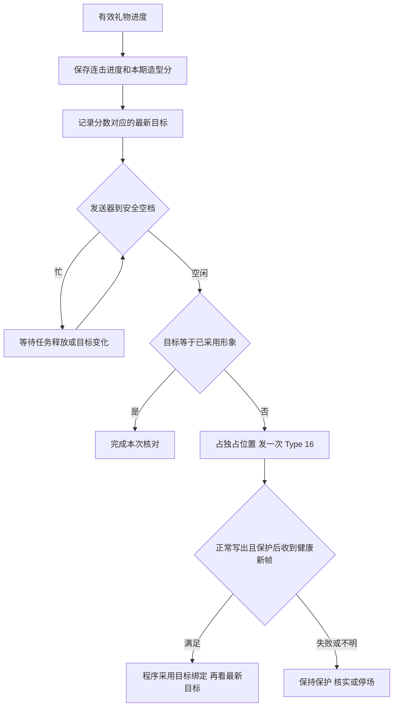

# 《恋爱军师团》玩法与接入设计：约会前照镜子

2026-11-05 设计，2026-11-07 补记两档离线验收、第二版六档美术定稿和正负两支转场。游戏现已接入六档、两支转场和真实协议适配。工作台可免费试玩，正式换形需补齐资产及云端地址。[工作台操作](04-本地工作台使用.md#约会前照镜子)。真实礼物流和本男主的双向换形待验。

**每期男主以普通形象、50 造型分出场。** 礼物 ID 决定正向或负向，1 钻对应 1 分，全体观众共同改变本期造型分。分数逐笔限制在 0–100，超出的部分当笔作废。0 分专属鱼人头，100 分处于最高档。跨档时触发同一男主的 Type 16 换形。女生只按男主这条消息发出时已生效的形象认识他。

**读稿先看三个时刻：** 收到可信礼物就记分；发送器空出来才换脸；男主消息气泡公开时，给这条消息保存一个不会再变的头像。比如分数已经是 62、人物还在用普通形象讲话，这条消息就可能仍是普通头像。观众看到的分数、直播中实际出现的脸、历史消息上的头像各有用途。

## 1. 一轮节目怎样演

观众一边替男主想回复，一边给他收拾造型。两件正向 6 钻让分数从 50 到 56，再到 62。按下表的试玩区间，第二件触发“洗脸中”：他拿毛巾遮住镜头，再露面时理好了刘海。女生问“周六我怎么认出你？”，军师选的回复是“认我的绿围巾，我在门口等你。”如果发消息时已切到精致，她看到的就是精致头像，可以回“绿围巾我记住了。头像这撮头发也是刚梳好的吧？”

之后收到一组负向 12 钻，造型分回到 50。用“熬夜打游戏”过场切回普通。刚才那条消息仍显示精致；若两组礼物都发生在发消息前，且画面已经回到普通，女生只看到普通，本轮没有新的外观印象。观众仍可免费支招、投回复票。送礼不占建议名额、不给回复选项加票。

**资产表（仅中间分界是试玩建议）。** 工作台配置“礼物 ID → 正/负”和“整数闭区间 → 已就绪资产”两张表。启用前检查全部 101 个分值各命中一次，同时锁住 0、50、100 的已定含义。每期固定配置版本，下一期开场可换规则。

| 造型分 | 资产 | 人物窗里的区别 |
|---|---|---|
| **0** | **鱼人头，最丑的特殊造型** | 整颗银灰鱼头，完全遮住人脸。戴手表的人手托着鱼鳃，沿用咖啡馆机位和男主声线 |
| 1–19 | 丑／通宵残局 | 发绺垂到眉眼，眼神疲倦，深色旧 T 恤和挂在颈间的大耳机 |
| 20–39 | 不好看／没睡醒 | 头顶翘起一撮乱发，橄榄色连帽衫，刚睡醒的神情 |
| 40–59，含 **50** | 普通／咖啡馆日常 | 平直刘海、灰色圆领卫衣，每期从这张日常造型出场 |
| 60–79 | 精致／收拾好了 | 低侧分露眉，浅蓝衬衫叠白 T 恤，神情清醒 |
| 80–100，含 **100** | 巨帅／约会高光 | 使用已选的咖啡馆原图，蓬松黑发、黑针织衫、暖光托腮 |

定版男主「咖啡馆里的温柔凝视」是整个角色的外观参照，在游戏六档中归入**巨帅档**。对应既有 Vidu 资产 `1015851675149152256`，3:4，音色 `longtian_v3.1`。开场 50 分对应灰卫衣普通档。五档人形锁定同一张脸、托腮机位和手表，0 分鱼头靠手表、姿态、咖啡杯和场景延续角色身份。归档材料包括六档对照、精致单图和巨帅原图。其他造型的独立可驱动资产仍待制作。[六档造型定稿](../artifacts/咖啡馆男主-Type16转场-v1/定稿/六档造型.png) · [精致单图](../artifacts/咖啡馆男主-Type16转场-v1/定稿/精致-3比4.png) · [巨帅原图](../artifacts/咖啡馆男主-Type16转场-v1/定稿/巨帅-咖啡馆原图.png)

两支无声过场按**实际形象到最终目标的档位方向**选用。向上含离开 0 分鱼头，播放「洗脸收拾」。向下含进入 0 分鱼头，播放「熬夜打游戏」。同档只更新分数，跨过几档也只为最终目标播一支。两片都在人物窗内满幅播放。云端接入时按方向只取对应短片的一个 HTTPS 地址，正常换形由 Studio 按成功写入、3 秒转场保护和保护后的健康解码帧自动衔接；实际造型与转场的视觉效果仍须看接收画面验收。[正向短片](../artifacts/咖啡馆男主-Type16转场-v1/wash-up.mp4) · [负向短片](../artifacts/咖啡馆男主-Type16转场-v1/night-game.mp4)

两支短片各长 **1.40 秒**。正向「人类抛光」用黄铜水龙头、水珠、毛巾擦镜和亮星，把收拾自己拍成一道抛光工序。负向「最后一把」里，手柄按键跳动，屏幕上的飞船持续开火，桌钟从 23:58 跑到 04:17，字幕悄悄把“一”改成“亿”。这两支成片各讲一个笑点。

下表是可替换上述题材的**后续分镜创意**。每个都可单独拍成约一秒的小片，笑点落在观众看得见的最后一个动作上。

| 正向 | 负向 |
|---|---|
| **刘海和解了**。梳子经过，三撮乱发排齐，最后那根慢半拍自己坐下。 | **枕头代做发型**。枕头弹开，一撮头发顶着方方正正的折角立起来。 |
| **猫毛大撤退**。粘毛滚筒滚过针织衫，带走的毛刚好卷成一只小猫。 | **发型先下班**。电扇咔哒开到三档，梳子留在原地，一排刘海齐刷刷倒向另一边。 |
| **衣领起立**。小熨斗从左到右滑过，两片翻领依次挺起来，像在报到。 | **拿铁先穿上了**。咖啡杯晃一下，杯里那颗拉花爱心原封不动印到衣襟上。 |

## 2. 礼物怎样算分

造型分由游戏计算。只有处于本期可参与状态、来自指定房间且 ID 在本期规则表内的可靠礼物才能入账。一次单送可视作独立的一组。连击按来源、房间、送礼者、礼物 ID 和可信组号识别，首次接纳时固定所属期、规则版本、单价和方向。消息 ID 去掉原包重放，组级累计处理“同一次连击有多个不同消息 ID”的情况。

```text
V = 经核实的单件钻石值 × 经核实的本组累计件数
H = 该组已处理过的最大钻石总值（新组为 0）
d = max(0, V − H)                         # 本次新收到的钻石数
H' = max(H, V)                            # 包括本次溢出的部分
S' = min(100, max(0, S + 方向 × d))       # S 为入账前造型分，方向为 +1 或 −1
实际变化 = S' − S
本次溢出 = d − abs(实际变化)
```

按游戏**接纳顺序**给有效进度编号，在同一笔 SQLite 提交中保存去重依据、H'、造型分前后值、实际变化、溢出和由 S' 得出的最新目标。提交后再唤醒发送器。每次从上一次已裁切的 S 出发，满分继续送正向，或零分继续送负向，均消耗这次连击进度，造型收益为 0。前端可提示“已到顶，本次造型 +0”。同档内实际变化照计，跨档才需要切资产。

| 逐笔输入（各行独立） | 应得到的结果 |
|---|---|
| 50 分，正向 6 钻礼物累计件数依次为 1、2、2、结束 2 | 56、62、62、62；只在 62 时新命中精致。另一组负向 12 钻使其回到 50 |
| 98 分，正向组 A 首次已累计 10 钻，再收到另一组负向 6 钻 | 100（实加 2、溢出 8），然后 94。A 的 10 钻结束包重放仍为 94；A 的可信总值升至 12 时仅加 2，得 96 |
| 100 分正向再送 20 钻，然后负向 1 钻 | 100（本次 +0），再到 99；按示例两者同属巨帅，均无新 Type 16 |
| 2 分，负向 10 钻，再正向 1 钻 | 0（实扣 2，鱼人头），再到 1（恢复人形，进入丑档） |
| 同样从 98 出发，先 −6 再 +10 | 92 → 100。与先 +10 再 −6 的 94 不同，所以不能把一批礼物先求和再裁切 |
| 50 分，负向一次 100 钻 | 一次落到 0，直接以鱼人为目标，无需逐个演中间档 |

**字段和边界。** DyHub 保留礼物 ID、单价、可信发生时间和可用的连击计数。工作台启用并核验数量口径后，匹配房间的订阅同时接收 chat 和 gift。收据、连击高水位和该笔造型分在同一 SQLite 事务中保存。[归一化](../../dyhub/src/pipeline/normalizer.ts) · [接收客户端](../../ai-live-avatar/studio/dyhub_client.py) · [游戏入口](../romance/dyhub_intake.py)。实流中先确认单价与累计件数，三种计数不能相乘。组号为 0、组价冲突、错房、过期或不能证明归属的事件不入账，只有能独立识别的单送才按 1 件。重复结束包增量为 0；结束包首次带来更大可信件数时补差。旧组归属保留跨期去重能力，新期不能把旧结束包认作首包。断线期间漏收不承诺重建。本机[历史实测](../../artifacts/dyhub-live-check-20261102/验证结论.md)中礼物为模拟样例，登录态和数量语义待现场验证。

## 3. 已有指令怎样跑，Type 16 从哪里插入

游戏通过本机独占接口向 Studio 交任务；只有 Studio 操作 Vidu 组件控制连接。游戏新增了本机“同角色换外观”控制请求，云端使用**已有 Type 16**，不新增云端 Type 编号。工作台表现出“收到礼物”、游戏已记分、Type 16 已写出、接收画面已换好是四个分别可核对的事实。

| 当前通道／指令 | 真实含义 | 与礼物的关系 |
|---|---|---|
| 出站 Type 1、入站 Type 2 | 初始化连接／返回初始化状态。组件 ready 后还要满足接收端就绪条件 | 复用同一已开场连接；每次换形不重开云场或 RTC |
| 出站 Type 9 | 发送动作描述。GE 是眼神表情前导，S 是主动短动作，Q 是收束眼神表情。它们都是本地角色标签，底层是同一种 Type 9 | 进行中的动作组完整发送。Q 在正常对话中不含肢体回位指令，不能把“Q 已发”当作画面已回正 |
| 出站 Type 10 + 同一连接的二进制 PCM | Type 10 是配套朗读文字；声音由 24 kHz、单声道、16 位 PCM 发送，每个完整帧 4,800 字节即 100 毫秒 | 不在 Type 10 与 PCM 之间、PCM 帧之间或语音尾部插 Type 16。无声低头任务只用 Type 9 |
| 出站 Type 16 | 在组件 WS 一次发 `switch_avatar: {avatar_id, switch_videos}`，伴随 live_id、conn_id、seq_id。发送器支持 1–10 个视频地址，本玩法每次传一支服务器已批准、云端可访问的 HTTPS 短片 | 只在安全空档派发，最多一个在途；目标取最新分数。云端没有可依赖的成功回执 |
| 入站 Type 103 / Type 12 | 103 中仅 `source=switch_avatar` 且整数 seq_id 对应本次已登记请求，才是可归属的切换失败。现有 12 进入可选 ACK 钩子 | 12、没有收到 103、播放器心跳均不证明换形成功。无归属的 103 沿用组件故障处理 |
| 出站 Type 5、入站 Type 6 | 主动挂断／平台结束组件。停止流程回读云端 ended | 停场优先。停止过程中不为补齐造型另发 Type 16 或收尾 Q |

以上仅覆盖当前组件版游戏路径。独立待机若开启，其 I（待机动作）与 Q（待机恢复）也是 Type 9；游戏接管前要求待机空闲。历史 Type 11、15、97、固定回放和长文实验不作为本玩法换形前置指令。[组件生命周期与音频](../../ai-live-avatar/studio/component_live.py) · [动作与切换发送器](../../ai-live-avatar/studio/motion_component.py) · [待机恢复](../../ai-live-avatar/studio/idle_motion.py)

**一组正式任务的实际顺序。** 选定建议后，游戏冻结正式回复和男主短反应。节目调度先占住正式表演位置，撤销未发送的可选下一条，然后完成以下两项。在两项交接的短暂空隙也继续保持独占。

1. **说出反应。** Studio 用同次合成得到的真实字时间安排动作。Type 10 后发送 PCM。对一个带动作的锚点，GE 在 S 之前 1.1 秒，Q 在 S 成功发送后至少 1.5 秒，Q 距下一条 Type 9 至少 1 秒；连续两组带完整 GE/S/Q 的 S 至少隔 3.6 秒。锚点不同，GE 或 S 可以在首个 PCM 前，也可以在语音中；全程无主动动作则只发台词和声音。读弹幕的可选短读有自己的 R/S0 和短读语音，也由同一发送器完整收尾。正式反应完成须同时满足 PCM 发送结束、4 秒本地交接等待结束、动作尾任务结束、工作任务释放。4 秒是发送端等待，不能推算观众何时听完。
2. **低头输入并公开气泡。** 这是独立的无声任务，稳定 ID 为该反应任务 ID 加 `:typing`。从它的 GE 实际成功写出算起，S 最早在 +1.1 秒，Q 最早在 +2.6 秒。游戏读取到**本期、本任务的 S 成功写出**才公开男主气泡并冻结造型。Q 及整项发送结束、核对回执后才开始女生生成。女生开始生成时起至少再等 2.4 秒，回复与分数一同公开。该无声任务没有额外 4 秒排空。其起点还受上一条 Type 9 的冷却约束；目前该无声路径可能在冷却未清时过期，接入时须在受保护位置等待可入场或按原失败处理，不能改短间隔。
3. **算一个可核对的时间例子。** 假设首段 PCM 发送完的本地时刻是 4.0 秒、最后一个语音动作尾在 5.0 秒已完成，交接最早是 `max(4.0+4.0,5.0)=8.0` 秒。再假设所有门槛都满足且无排队，低头 GE 最早 8.0、S 9.1、Q 10.6；若女生立即开始生成，最早 13.0 秒公开回复。模型超过 2.4 秒则等模型。真实排队、网络、轮询会使这些时刻推迟。**这段期间来的礼物照常逐笔记分；整组交接之前，Type 16 发送次数必须为零。**

[正式任务与 S 回执](../romance/program.py) · [固定低头动作](../romance/performance.py) · [A 编排](../../ai-live-avatar/studio/semantic_speech.py) · [消息公开及女生结算](../romance/game.py)

## 4. 换形调度、自动采用和恢复



**调度顺序。** 停场／失去所有权最高；正在执行的内容或已占位的正式“口播＋低头”先收尾；到了可用空档，待切造型优先于下一句可选闲聊。已预约正式任务和新造型同时争用时先完成正式任务。这意味着礼物会马上计分，画面可能稍后才切。安全空档没有固定秒数；已有礼物待切时禁止无限补入新的可选话术。一次换形完成先重查正式任务，避免持续跨档让剧情一直发不出去。

| 礼物到达时所处的位置 | 计分及目标 | 下一步允许做什么 |
|---|---|---|
| 纯空闲，或只有可选下一句在规划／预制 | 立即入账，覆盖未发目标 | 先关闭新预制。未发送的可选任务按原 ID 撤销，等准备工作真正释放，再重新取最新目标。若已经开始发送则等它结束 |
| 正式反应已占位、正在说话、4 秒交接、低头 GE/S/Q，包括口播与低头之间 | 立即入账，保留一个待切目标 | 不插帧、不撤销已冻结正文。此时公开气泡只读当前已采用外观 |
| 女生正在生成／等公开，且男主完整任务已释放 | 本期仍 ACTIVE 时照常记分 | 若无其他任务占位可换形。本轮女生始终使用已冻结的消息快照；不重跑回复、不追改分数 |
| Type 16 已发，自动衔接期间又数次跨档 | 所有有效增减照计；在途请求参数固定，待切目标可更新，也可回到原样 | Studio 正常写出后等 3 秒保护，再要求同一接收端产生保护后的新解码帧且音视频健康，最多再等 15 秒。满足后采用目标绑定，再按最新目标至多派发下一次；若相同就不发 |
| 普通口播、切模式、开场准备、已终局或停场 | 该时期不接纳本期造型分，旧组不转新期 | 保留原评论订阅生命周期。已有在途切换纳入收尾，旧回执不能授权新一期发言或改分 |

**游戏与 Studio 都要守住空档。** 当前游戏独占时，Studio 的普通资产切换和恢复按钮会被中间件挡住。在 `external/*` 下提供有限的同角色外观请求和同 ID 查询；由现有游戏所有者调用。请求绑定 owner、Studio generation、节目模式代次、本期、稳定请求 ID 以及冻结的目标和过场键。Studio 按本机配置把键解析为已就绪资产和过场，复核同一会话、唯一接收端、队列/工作任务都已释放。如果存在待机恢复义务，先按原逻辑发相应 Q 并等保护间隔，恢复失败则挡住切换。底层复用整段表演锁与单次 WS 写锁；不能只看一个 `ready` 字段。分数如果在最后复核与实际写出之间又变了，已开始的写入按在途处理，不宣称可以撤回。

**游戏与 Studio 的指令约定。**

| 谁发给谁 | 表达什么 | 禁止的副作用 |
|---|---|---|
| 采集器 → 游戏：礼物进度 | 本房间一组礼物到达了多少；游戏按第 2 节去重并计算，只更新造型分和目标 | 不把礼物文字送入建议池，不直接调用云组件 |
| 游戏 → Studio：申请换形 | 本期请求号、目标造型键、过场键及所有权版本；Studio 校验后，用自己的资产 ID 和视频地址写一次 Type 16 | 不开新会话，不把一次礼物等同于一次 Type 16 |
| 游戏 → Studio：查询同一请求 | 回读未写出／已写出自动衔接中／已采用／失败／未知；返回本次请求号，写出时附组件序号 | 查询、轮询、网页刷新都不能重新发送 |
| Studio → 游戏：自动采用回执 | `applied/program_adopted=true` 只表示按发送、保护和健康帧采用绑定；游戏再核对 Studio 健康与档位后解除程序保护并检查最新目标，无人工确认 POST | 不写人工/视觉/播放成功；`operator_confirmed/visual_confirmed/playback_confirmed/success_acknowledged` 均为 false |

**同角色换装与预制内容。** 当前普通资产确认会更新角色设置、音色、身份代次、导演上下文及默认选择；游戏同角色外观绑定仅更新本场实际图像、资产及外观版本，沿用本期角色、原声音色和剧情历史。预制缓存已绑定资产、图片摘要、音色、计划及任务，换形后旧缓存不能派发。正式任务已占位就先完整完成，取消的是未发的可选预制，不为清队列重做已付费的 TTS。程序采用后再用新外观准备后续任务。[独占与任务门槛](../../ai-live-avatar/studio/external_game.py) · [手动切换与独占中间件](../../ai-live-avatar/studio/server.py) · [预制缓存指纹](../../ai-live-avatar/studio/live_session.py)

**请求的几种结果。** 游戏先持久记录本次请求意图和 ID，再经桥接发出。相同 ID 和参数只能查询/复用同一次操作；同 ID 改目标拒绝。明确在 WS 写入前撤销时，旧形象已知，可以重新调度最新目标。写出标 `written`，按上述保护与健康帧门槛通过后标 `applied`，仅表示程序采用；`confirmed_key` 是兼容字段名，不是实际视觉确认。没有 Type16 成功 ack，不能从 Type12、片长或心跳推断目标造型与转场已成功播放。

收到可归属的103、接收端异常或结果未知时保持保护，Program 立即暂停推进，不等人点击、不自动重试。pending/written 超过45秒仍未收敛也只报错，不按计时造成功。连接中断、部分写入、回包丢失或重启时只能先查询**同一请求**；无法证明未发送就禁止盲目重发、补开云场或拿分数反推画面。已采用后收到迟到103会重新锁住并请求停场，不倒改历史消息。等待期间仍允许停止与心跳，不持有应用锁。旧 original_dynamic 人工核实原貌接口仅作故障兼容，不恢复已故障的 Program；正常流程无确认入口。真实目标动态、转场、音色和录像另行场内验收。

## 5. 一期的完整接线

| 环节 | 现有职责 | 本玩法要接入的部分 |
|---|---|---|
| 开场／换期 | 正式工作台先普通口播，开始游戏才进入本期。节目持有同一 Studio 会话；普通聊天与游戏分别推进 | 核对礼物映射、六档资产、声音与过场，自动采用普通造型后从 50 分开始收礼计分。普通游戏保留造型条和匹配的礼物图例，收礼关闭时标明初始 50、未计分。指定的一钻组合可在首场实播逐包核验，无需预先声明现场已核量 |
| 征集／投票／决定／措辞 | 收集建议、每人投票、锁票、既有冲突裁决和真实作者来源；正式男主消息先保存，稍后公开 | 礼物另路入账，可跨这些阶段；不成为建议和选票，不传入候选编选或来源裁决。阶段窗口按服务端原截止，不因造型延时重新开票；已结束的阶段话术照常失效 |
| 普通互动、男主与女生 Agent | 正式反应、候场闲聊、女生回信各有自己的输入 | 男主在已采用后可自然提当前造型，准备中的旧闲聊用外观版本校验。男主正式气泡带本轮头像小图。只向女生传已公开的可见描述（例如“头像里他把头发梳开了”）和必要的前后比较；不传后台造型分、礼物、投票或未发草稿。每份礼物不增加一次模型调用 |
| 分数、奖项 | 女生回信、亲密度、终局及奖项一并提交。现有本期奖和跨期双榜使用回合实际分数变化 | 造型分与亲密度虽皆从 50 开始，**造型 0/100 只决定资产，亲密度 0/100 才决定本期剧情结局**。保留下述“聊天／外观印象”拆账，一次女生调用、一次结算；建议作者只按实际聊天分归功或扣分 |
| 画面与工作台 | 手机预览、透明叠层、OBS 节目输出共享渲染；同场只设一个 RTC 接收端 | 人物窗显示实际造型，造型分与亲密度分开标注。未采用时可标“换形中”，不拿静态新图冒充实时成功。对话按历史快照取头像。操作者另见识别状态、待切/在途/实际资产、错误和自动衔接状态；公开画面隐去用户原始 ID、凭据、云地址。复用同一播放器而非每次换形重挂 iframe |
| 终局、退出、停场 | 回复和分数一起结算。正式模式颁奖后回同场普通口播，直开游戏的调试模式可换期 | 正常终局提交时同步关本期礼物入口并撤销未发目标，颁奖原有 6.8 秒动效与至少 8 秒停留照常。回非游戏口播时在独占窗口恢复本场口播形象；新期开场时另行核对普通档并重置造型分为 50。手动退出同样撤销旧期写权限。若是结束整个云场，优先停场，不为还原多切一次；创建未知或停止未确认时禁止另开 |
| 保存、回滚、人工重试 | 游戏单进程 SQLite ，正式消息一经提交不可改写；Studio 外部任务启动时不自动重放 | 本期保存配置快照、造型分/版本、组进度、可核对的入账和操作状态。公开男主气泡时，把 `message_id → 实际外观版本/小图/描述` 存入回合快照，同一事务更新公开标记，保留已写入的消息正文。纯文字演练在消息首次公开时用明确标记的模拟外观；旧档无快照走原路径。刷新只回读；异常停用先关入账与新派发，核实在途及实际形象后回普通模式，不回退历史分数 |

**女生怎样判分。**女生用同一次回复给出对男主这句话的聊天变化，以及首次看到新造型时的印象变化（试玩建议整数 −2 到 +2，可为 0）。以女生上一次可见的头像为比较基准，首次用开场普通做基准；同形象、版本反复但外观已回原样、缺快照均记外观变化 0。先用聊天分算出并裁切到 0–100 的聊天结果 B。如果 B 达到端点且女生明确答应交往／结束追求，与现有终局校验一致，则当轮印象分为 0；否则继续轮要求 0 < B < 100，取印象提议中不会让总分触端的最大整数变化：保留印象提议自身的正负方向，幅度最多为原提议，必要时缩到 0。聊天和印象可以方向相反；例如聊天 +4、印象 −1，亲密度从 50 到 53，军师仍记 +4。继续轮若聊天本身已碰到端点，按现有一致性校验拒绝这份模型结果，不靠印象把它拉回。例如亲密度 97，聊天 +2 到 99，印象提议 +2，实加 0；50 分时聊天 +4、印象 +1，结果是 55，军师按 +4 计。不得因外观把继续轮强行变成终局。正负次数和狗头累计扣分读实际聊天变化，旧轮兼容原 delta。模型重试沿用本条消息快照，不重发男主表演或重计印象。

主要实施落点：[节目生命周期与优先级](../romance/program.py)、[游戏调用 Studio 的桥](../romance/avatar_client.py)、[游戏结算与公开投影](../romance/game.py)、[模型输入](../romance/model.py)、[事务与消息不可变约束](../romance/storage.py)、[公共渲染](../static/renderer.js)、[OBS 接收端](../static/obs-output-player.js)。沿用现有单进程与存储，不另设礼物服务。

## 6. 分段验收与上线边界

| 阶段 | 必须能拿出来核对的证据 |
|---|---|
| ① 本地规则回放 | 六档覆盖全部 0–100 整数；运行第 2 节全部边界例子。覆盖同组重复/乱序、不同组交错、单送/连击、不同 ID 同价反向、未知字段、满分丢溢出后收到结束包、换期迟到和重启恢复。回读组已经消费的钻石和实加分，两者允许不同 |
| ② 游戏＋模拟 Studio | 回放礼物落在预制、首帧 PCM、4 秒交接、低头 S 前/S 后、Q 后及女生生成中的情况。记录游戏接纳序号、请求号、任务号、Type/seq、消息外观、实际分及奖项。证明没有夹入 Type 16，发送截止前后各读对一次形象；待切目标合并、同资产零次发送、满额仍能继续原剧情。丢回包、迟到 103、自动采用健康门槛、模式切换、停场和重启均不重发 |
| ③ 授权房间只观察礼物 | 在自有已登录房间对照自然送礼的价格、数量、组号、结束包和重连语义。房间没出现可对照样本即保持待验；评论能收到或合成夹具通过不能替代这一项 |
| ④ 明确授权后的付费短场 | 先只用普通↔精致，以一个现有接收端验证去回两支短片、转场后的动态嘴眼、同一音色、白边和下一句；再测鱼头全挡脸时的动态表现和从 0 分升至 1 分恢复人形。分开留存写出、接收播放、实际换形、录像以及云端 ended/账单。核对手机构图后才扩全档。[旧跨资产实测](../../artifacts/vidu-type16-cross-old-to-smile-20261030/交叉试验结果.md)确实换过，也出现持续白边；[自定义短片记录](../../artifacts/type16-neon-break-20261030/替换说明.md)仅证实上传绑定 |
| ⑤ 商用确认 | 本地玩法明确“满分/零分同方向再送只作礼物收件反馈，外观收益 +0”。抖音对累计消费触发效果、付费无反馈、虚拟主播丑化均有规则；当前“累计钻石跨档”与准入条文有直接冲突风险，改显示文字不能解决。仅作本地验证；公开付费前须以此机制和素材核对准入、提审。若不被允许，保留换形引擎，把公众版改成免费评论影响分数，指定礼物只触发当次有反馈的独立效果，再提交审核。[付费设计准入条款](https://developer.open-douyin.com/docs/resource/zh-CN/interaction/introduction/introduction/creation) · [虚拟主播互动 FAQ](https://developer.open-douyin.com/docs/resource/zh-CN/interaction/introduction/zn/FAQ) · [礼物互动能力](https://developer.open-douyin.com/docs/resource/zh-CN/interaction/jierushuoming/hudongshuju/liwushuju) |

### 2026-11-07 两档离线验收

游戏实际走完征集、投票、男主正式口播、低头发消息及女生结算。模拟礼物直接输入游戏采集回调，Studio 使用真实组件发送代码，把 Type 9、Type 10、PCM 和 Type 16 写入内存连接。模拟接收端根据 Type 16 包里的资产编号确认造型。口播保留 4 秒交接等待。头像由模拟资产键和可见描述表示。模拟女生根据收到的描述选用回复，游戏在内存 SQLite 保存本轮消息及头像。

| 送礼时机 | 男主公开消息时 | 女生开始回复时 | 女生实际收到的消息头像 |
|---|---|---|---|
| 50 分收两件正向 6 钻。低头 S 公开气泡后、Q 前收到负向 12 钻 | 62 分，精致 | 50 分，已切回普通 | 精致，回复提到梳起的刘海 |
| 50 分普通口播发送首帧 PCM 时收到正向 12 钻 | 62 分，仍是普通 | 62 分，已切到精致 | 普通，回复提到自然垂着的刘海 |

两轮中，从正式口播开始到低头任务结束，中间的 Type 16 都是 0 次。主场景的两次换形分别在口播前和低头 Q 完成后，对照场景的唯一一次换形也在 Q 完成后。验证同时比对了内存连接上实际写出的包、游戏保存的头像、女生收到的回复对象和公开气泡的消息 ID。

从 `romance-advisors/` 目录运行 `PYTHONPATH=. .venv/bin/python -B tests/test_appearance_round.py --json` 可复现两轮并输出事件顺序。当前验收仅覆盖普通和精致的离线调度、头像快照及回复输入。真实资产播放、真实女生模型的自由回复及直播礼物流仍待验证。[两轮原始记录](../artifacts/appearance-round-offline-20261107/round-trace.json) · [可复跑用例](../tests/test_appearance_round.py)

## 2026-11-07 游戏接入验收

工作台免费试玩已从页面按钮跑过 50 → 62 → 50 → 0 → 100，浏览器实播原版上下档短片，并从 OBS 节目页回读巨帅终态。当时正式入口的隔离用例使用有真实协议字段的合成礼物、临时 SQLite、模拟 Studio 和女生模型，验证当时的人工确认合同、冻结消息头像、独立计分及整组动作保护。Studio 的本机 HTTP 换形接口单独验过所有权、指纹、音色、双向选片和结果不明时的阻断。真实房间礼物、真实云端播放和鱼头动态仍待现场检验。[浏览器回读](../artifacts/appearance-game-integration-20261107/browser-playback.json) · [正式收礼到回信的用例](../tests/test_appearance_live_intake_round.py)

### 2026-11-07 自动衔接合同补记

正常开局、收礼跨档与退出恢复口播改为上述自动采用，不再每次人工确认。新增[完整离线协议用例](../tests/test_automatic_appearance_protocol.py)在不提供确认接口的情况下串起生产采集、计分、Program、HTTP 桥接、Studio 和共享 Type16 发送器；合成礼物回放 50 → 70 → 100 → 10 → 0 → 25 → 50，覆盖六档并恢复同场口播。还覆盖正式口播＋低头 S/Q 保护、Q 后一秒、保护后停帧、失败/未知不重试及查询期限。音频、WS 与健康帧均为替身，保护时间缩短；只能验收自动程序契约，真实礼物流、目标动态和云端音画仍待实播。
